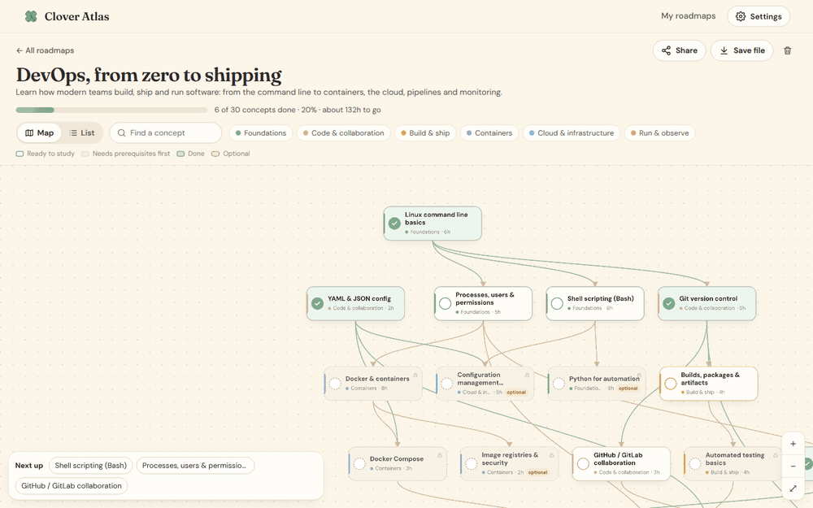
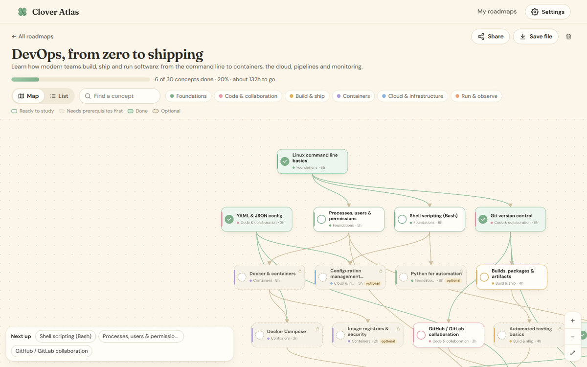
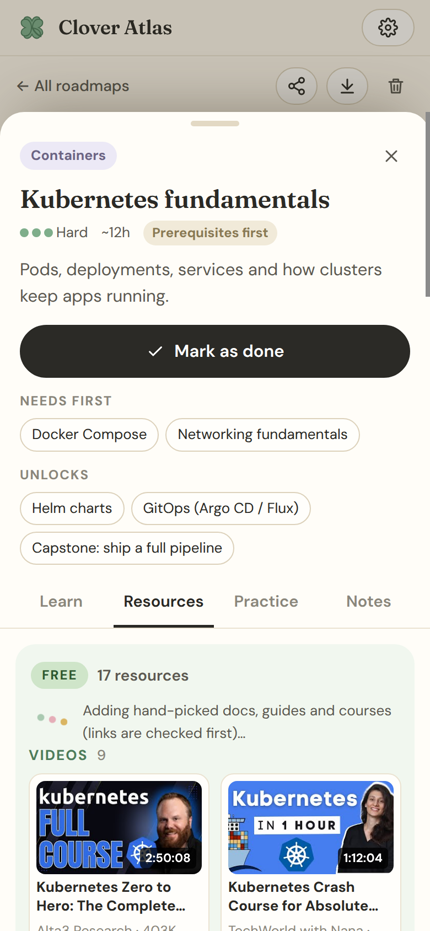
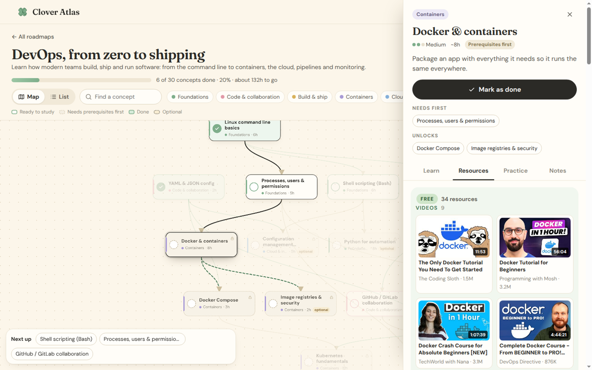
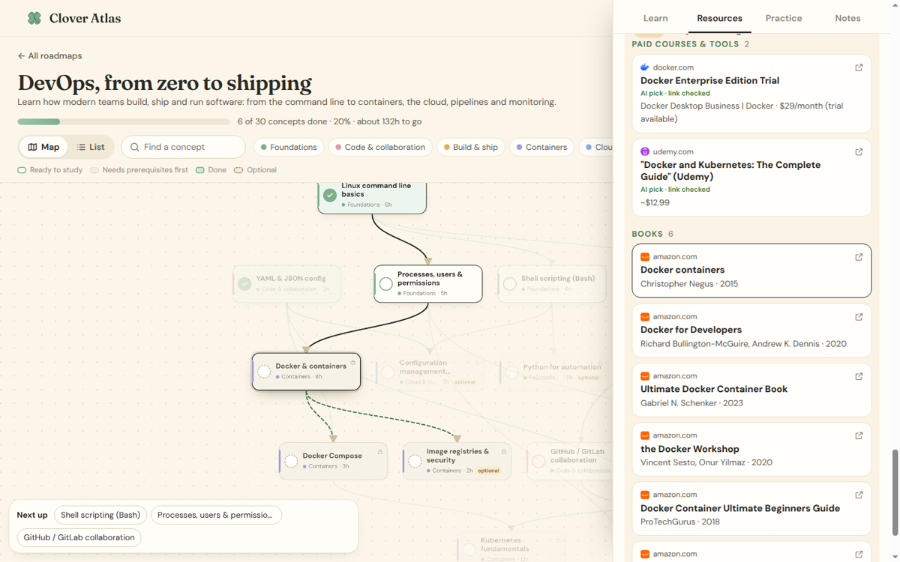
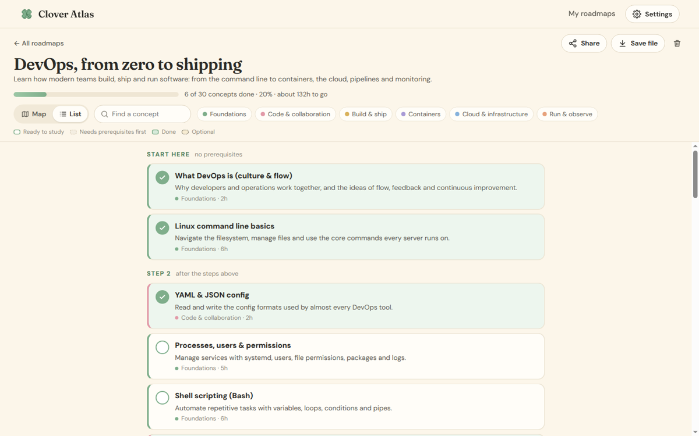
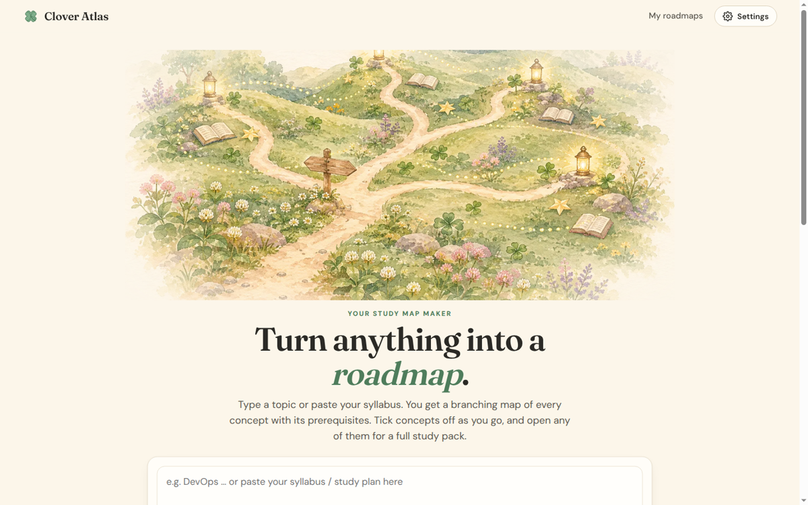

<p align="center">
  
</p>

<h1 align="center">
  &nbsp;Clover Atlas
</h1>

<p align="center">
  <em>Type one word or paste your syllabus. Get the whole map of what to learn, in the right order.</em>
</p>

<p align="center">
  
  
  
  
</p>

<p align="center">
  <a href="https://vercel.com/new/clone?repository-url=https%3A%2F%2Fgithub.com%2FLyra-4leafclover%2Fclover-atlas&project-name=clover-atlas&repository-name=clover-atlas"></a>
</p>

<p align="center">
  
</p>

---

## 🍀 &nbsp;What it does

Give Clover Atlas anything: *"DevOps"*, *"organic chemistry"*, a course name, or your whole syllabus as text or a PDF. It draws a branching roadmap of every concept you need, with arrows showing what to learn first.

<table>
  <tr>
    <td width="33%" valign="top"><b>🗺️ &nbsp;A real map, not a list</b><br>Concepts branch and merge in colour-coded tracks, with prerequisite arrows, optional side-quests and a capstone at the end.</td>
    <td width="33%" valign="top"><b>📚 &nbsp;Nothing skipped</b><br>The AI plans the full curriculum first, then fills in each part. It keeps every topic from your syllabus and adds the basics it assumes. That's 30 to 90 concepts.</td>
    <td width="33%" valign="top"><b>✅ &nbsp;Tick as you go</b><br>Check concepts off and watch the progress bar fill. Concepts stay faded until their prerequisites are done, and "Next up" shows what's ready.</td>
  </tr>
  <tr>
    <td valign="top"><b>🎬 &nbsp;Real resources</b><br>Every concept links straight to real YouTube videos, docs, articles, courses, Q&amp;A, GitHub projects and books. No search links.</td>
    <td valign="top"><b>💸 &nbsp;Free and paid, split</b><br>A big Free section (often 30+ links) and a smaller Paid one with courses and books. Links are checked before they're shown.</td>
    <td valign="top"><b>✍️ &nbsp;A full study pack</b><br>A plain explanation, a study plan, common mistakes, practice questions, flashcards, a mini project, an AI tutor and your own notes.</td>
  </tr>
</table>

## 🌸 &nbsp;A peek inside

<table>
  <tr>
    <td width="68%"></td>
    <td width="32%" rowspan="2"></td>
  </tr>
  <tr>
    <td></td>
  </tr>
  <tr>
    <td></td>
    <td></td>
  </tr>
</table>

<p align="center"></p>

## ✍️ &nbsp;How to use it

1. On the home page, type a topic or paste your syllabus. You can also upload a `.txt`, `.md` or `.pdf` file.
2. Pick your level and a size: **Compact** (about 30 concepts), **Full** (about 55) or **Deep** (about 90). Then click **Build my roadmap**. Big maps take 1 to 3 minutes.
3. Click any concept to open it. **Learn** explains it, **Resources** has the links, **Practice** has questions and flashcards, and **Notes** is yours.
4. Click **Mark as done** when you finish a concept. The next ones unlock.

There's a sample **DevOps** roadmap built in, so you can try it right away.

## 🎬 &nbsp;Where the resources come from

When you open a concept's **Resources** tab, the site's server looks things up for you. No keys are needed.

- **Within about a second:** real YouTube videos and full lectures, Wikipedia, popular articles from Hacker News, top Stack Overflow answers and GitHub projects (for tech topics), and books from Open Library (free to borrow) and Amazon (paid).
- **A bit later, in the background:** the AI adds official docs, guides, free courses and paid courses. The server opens each link first and drops any that are dead.

Each concept is saved once it has loaded, so opening it again is instant. **Refresh resources** fetches a new set.

## 🤖 &nbsp;AI options

Click **Settings** on the site.

- **Built-in** (default): uses a free public AI with no key. It's slower and simpler.
- **Your Gemini key** (recommended): faster and better maps. Get a free key at https://aistudio.google.com/apikey and paste it in. It's stored only in your browser.
- **OpenAI-compatible:** any key and base URL (OpenAI, OpenRouter, Groq and others).

## 🔒 &nbsp;Your data

There are no accounts. Your roadmaps, ticks and notes are saved in your own browser. Use **Backup** on the home page (or **Save file** on one roadmap) to download them, and **Import** to open them on another device. **Share** copies a link that gives a friend their own copy.

## 🚀 &nbsp;Make your own copy

**On Vercel (free):** click **Deploy with Vercel** above, sign in with GitHub, then click **Deploy**. Optional: under Project → Settings → Environment Variables, add `GEMINI_API_KEY` so everyone gets the better AI without a key. Then redeploy.

**On your computer:** you need Python 3. Open a terminal in this folder and run:

```
python3 server.py
```

Then open http://localhost:8000.

A plain static host like GitHub Pages or Neocities won't work here, because the resource finder and the AI run on the server.

## 🎨 &nbsp;Make it yours

| File | What it is |
| --- | --- |
| `css/style.css` | Colours and fonts. The `:root` colours at the top restyle the whole site. |
| `js/app.js` | The pages: home, roadmap, concept panel and settings. |
| `js/graph.js` | How the map is laid out, the arrows, and pan and zoom. |
| `js/ai.js` | The instructions given to the AI to build roadmaps and study packs. |
| `js/resources.js` | How free and paid resources are gathered for a concept. |
| `js/example.js` | The built-in DevOps sample. |
| `js/store.js` | Saving in the browser, backups and share links. |
| `api/ai.js`, `api/find.js` | The server parts on Vercel (AI and the resource finder). |
| `server.py` | The same server parts for running it on your computer. |
| `art/` | Watercolor artwork and icon. |

<br>

<p align="center">
  <br>
  <sub>made with care for every learner by Lyra</sub><br>
  <sub><a href="https://x.com/Lyra_void">X</a> · <a href="https://github.com/Lyra-4leafclover">GitHub</a> · <a href="https://lyradossier.vercel.app/">Portfolio</a></sub>
</p>
